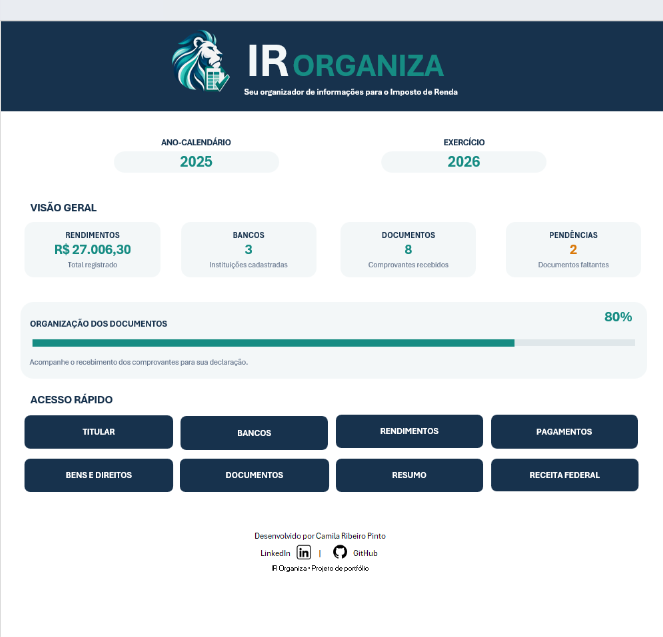
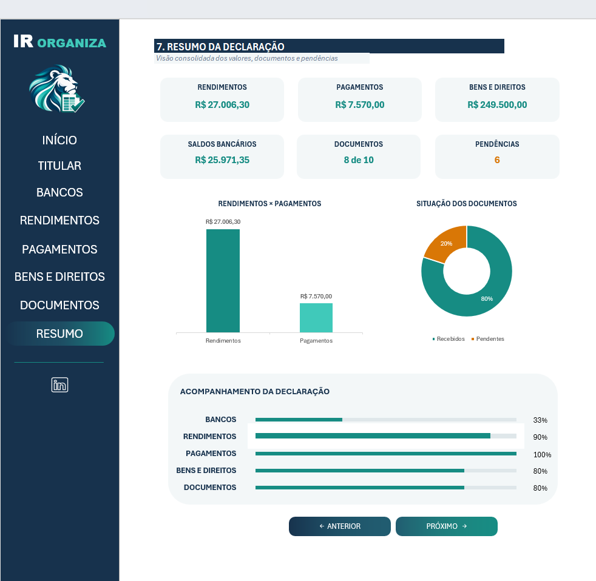
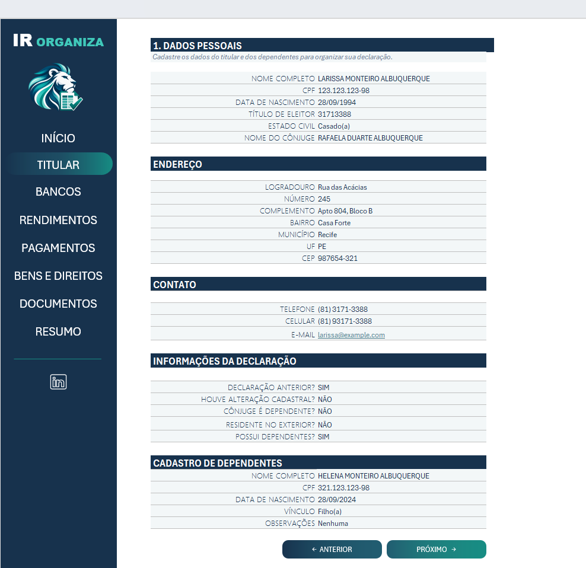
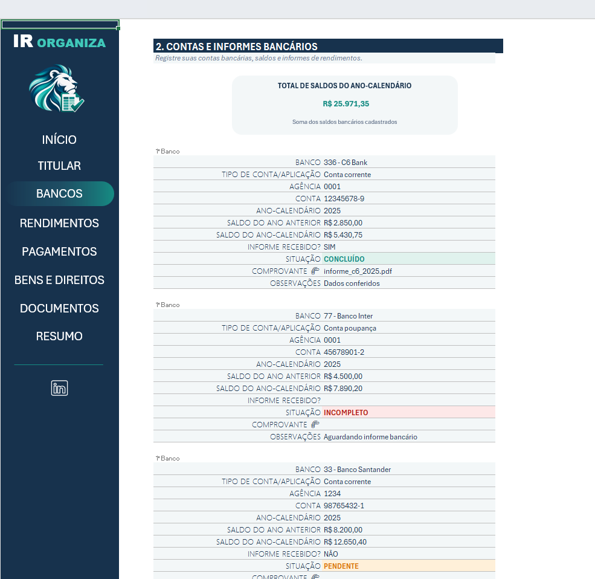
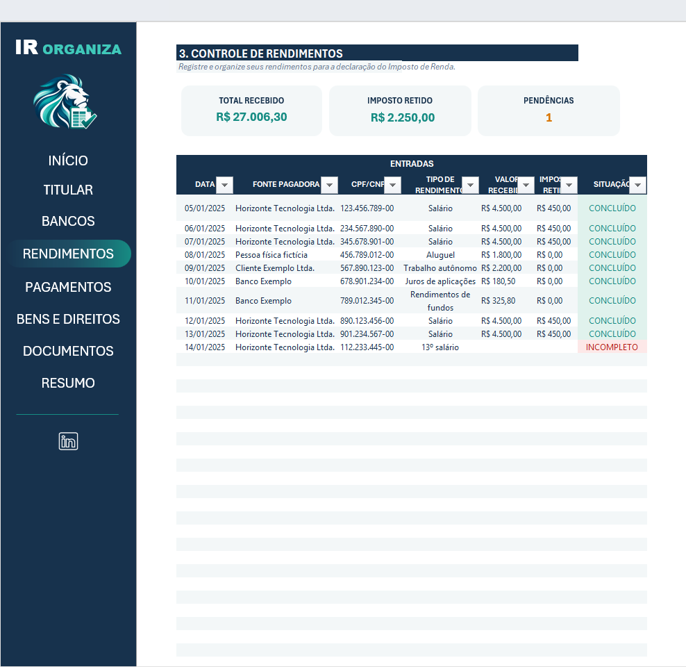
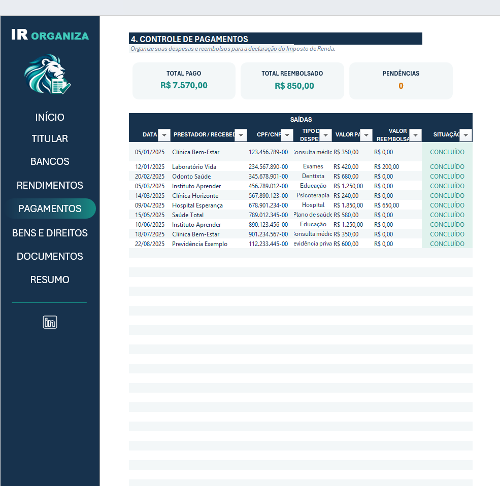
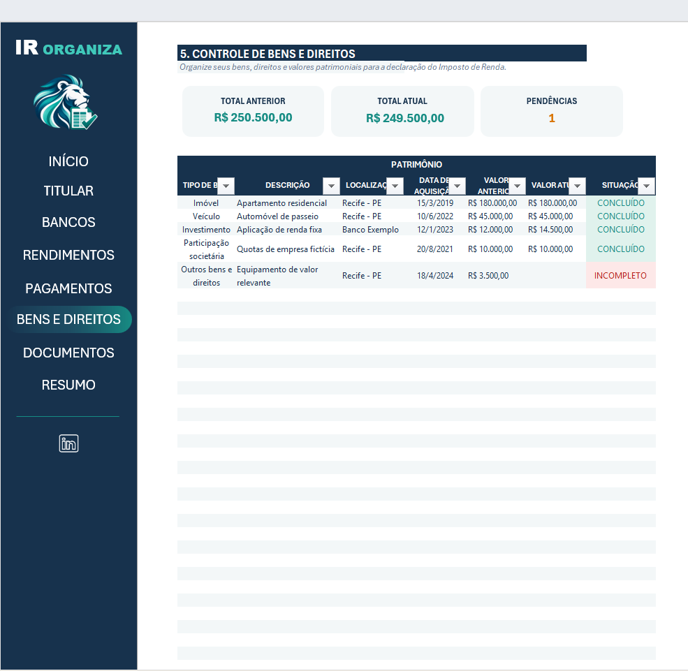
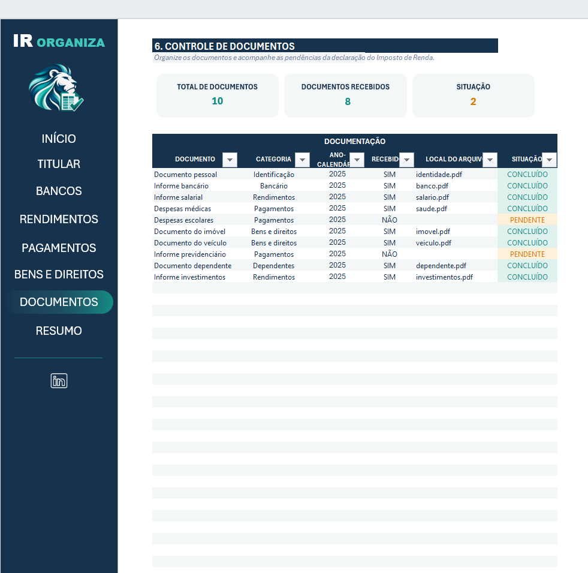
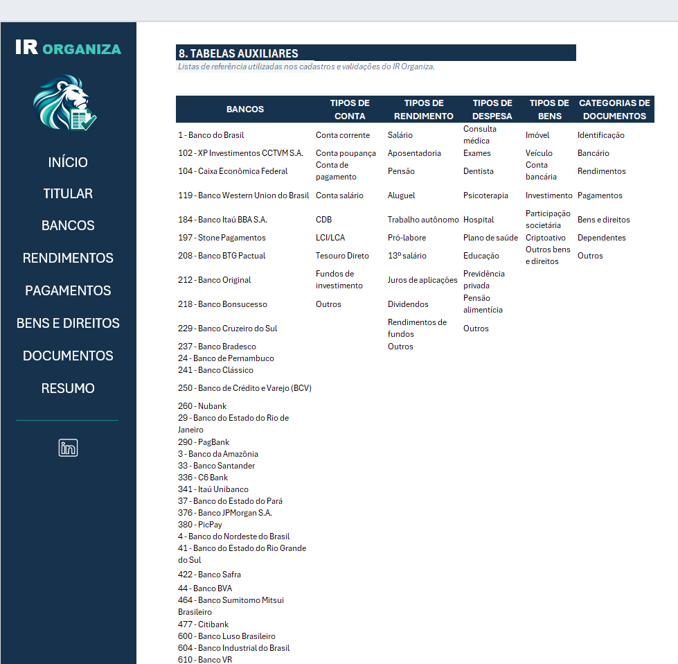

# IR Organiza

**Organizador de informações para preparação da declaração do Imposto de Renda, desenvolvido em Microsoft Excel.**

O **IR Organiza** centraliza informações cadastrais, contas bancárias, rendimentos, pagamentos, bens e documentos em uma única pasta de trabalho. A ferramenta reúne áreas de preenchimento, controles de pendências e um painel de resumo para facilitar a organização dos registros.

**[Baixar planilha Excel](https://github.com/camisarp/ir-organiza-excel/raw/refs/heads/main/IR_Organiza.xlsx)** · **[Conhecer a interface](#demonstração-da-ferramenta)** · **[Consultar instruções de uso](#como-utilizar)**

> **Escopo da ferramenta:** o IR Organiza apoia a organização das informações. Não calcula o imposto devido e não substitui o programa oficial da Receita Federal.

## Objetivo

Facilitar a preparação das informações utilizadas na declaração do Imposto de Renda, oferecendo um fluxo organizado de preenchimento e uma visão consolidada dos registros e documentos.

O projeto prioriza **clareza na navegação, padronização dos dados e acompanhamento de pendências**.

## Demonstração da ferramenta

Capturas de demonstração disponíveis no repositório.

### Visão geral

| INÍCIO | RESUMO |
|:---:|:---:|
|  |  |
| Apresentação, navegação e indicadores gerais. | Consolidação dos registros e acompanhamento visual. |

### Cadastro e informações bancárias

| TITULAR | BANCOS |
|:---:|:---:|
|  |  |
| Informações cadastrais do titular e dependentes. | Organização de contas, saldos e informes bancários. |

### Registros financeiros

| RENDIMENTOS | PAGAMENTOS |
|:---:|:---:|
|  |  |
| Fontes pagadoras, valores recebidos e imposto retido. | Despesas, valores pagos e reembolsos. |

### Patrimônio e documentação

| BENS E DIREITOS | DOCUMENTOS |
|:---:|:---:|
|  |  |
| Organização dos bens e respectivos valores. | Acompanhamento de comprovantes recebidos e pendentes. |

## Funcionalidades

| Recurso | Finalidade |
|:---|:---|
| **Navegação entre abas** | Facilitar o acesso às etapas de organização. |
| **Registros por categoria** | Separar informações cadastrais, financeiras, patrimoniais e documentais. |
| **Listas de seleção** | Padronizar o preenchimento de categorias. |
| **Controle de pendências** | Identificar informações ou documentos que exigem atenção. |
| **Resumo e indicadores** | Reunir os resultados em uma visão consolidada. |
| **Proteção de planilhas** | Preservar áreas de cálculo e apresentação durante o preenchimento. |

## Estrutura da pasta de trabalho

| Aba | Finalidade |
|:---|:---|
| **INÍCIO** | Apresentação da ferramenta, navegação e indicadores gerais. |
| **TITULAR** | Informações cadastrais do titular e dependentes. |
| **BANCOS** | Contas, saldos e informações bancárias. |
| **RENDIMENTOS** | Fontes pagadoras, valores recebidos e imposto retido. |
| **PAGAMENTOS** | Despesas, valores pagos e eventuais reembolsos. |
| **BENS E DIREITOS** | Registros patrimoniais e valores informados. |
| **DOCUMENTOS** | Controle de comprovantes e acompanhamento do recebimento. |
| **RESUMO** | Indicadores consolidados e gráficos de acompanhamento. |
| **TABELA** | Listas auxiliares para categorias e validações de preenchimento. |

## Organização da solução

| Componente | Responsabilidade |
|:---|:---|
| **Entrada de dados** | Registrar as informações nas áreas destinadas ao preenchimento. |
| **Listas auxiliares** | Apoiar a padronização das categorias utilizadas nos registros. |
| **Consolidação** | Reunir informações em indicadores, situações e visualizações de acompanhamento. |

Essa organização separa o preenchimento das estruturas de apoio e facilita a consulta às informações.

### Tabelas auxiliares

As listas de apoio ficam concentradas na aba **TABELA**.

## Tecnologias e recursos

| Recurso | Aplicação |
|:---|:---|
| **Microsoft Excel** | Desenvolvimento da ferramenta e da interface. |
| **Fórmulas e referências entre abas** | Consolidação de informações e cálculo de indicadores. |
| **Funções condicionais** | Definição de situações e sinalização de pendências. |
| **Tabelas e filtros** | Organização e consulta dos lançamentos. |
| **Validação de dados** | Padronização do preenchimento por listas de seleção e critérios de entrada. |
| **Intervalos nomeados** | Apoio às listas e referências da pasta de trabalho. |
| **Formatação condicional** | Destaque visual de situações e informações. |
| **Gráficos** | Apresentação dos registros consolidados. |
| **Hiperlinks internos** | Navegação entre as áreas da ferramenta. |
| **Proteção de planilhas** | Preservação das áreas de cálculo e apresentação. |

## Como utilizar

1. **[Baixe o arquivo IR_Organiza.xlsx](https://github.com/camisarp/ir-organiza-excel/raw/refs/heads/main/IR_Organiza.xlsx)**.
2. Salve uma cópia própria antes de preencher suas informações.
3. Abra no **Microsoft Excel para desktop**.
4. Comece pela aba **INÍCIO** e acesse **TITULAR**.
5. Preencha os campos disponíveis nas abas **BANCOS**, **RENDIMENTOS**, **PAGAMENTOS** e **BENS E DIREITOS**.
6. Utilize **DOCUMENTOS** para acompanhar a organização dos comprovantes.
7. Consulte **RESUMO** para visualizar os indicadores e as pendências.

> **Privacidade:** utilize dados fictícios em arquivos e capturas destinados à demonstração pública. Não publique CPF, dados bancários ou documentos pessoais reais.

## Arquivos do repositório

| Arquivo ou pasta | Conteúdo |
|:---|:---|
| [IR_Organiza.xlsx](IR_Organiza.xlsx) | Pasta de trabalho do projeto. |
| README.md | Apresentação e documentação da ferramenta. |
| [images/](images/) | Identidade visual e capturas das abas. |

## Aprendizados

O projeto explora a integração de recursos do Excel em uma ferramenta com fluxo de uso definido. Os principais pontos de desenvolvimento envolvem:

- Organização das informações em etapas de preenchimento.
- Padronização dos registros com validações e listas auxiliares.
- Consolidação de dados em indicadores e gráficos.
- Construção de uma interface com navegação consistente.
- Documentação da finalidade, dos recursos e das limitações da solução.

## Desenvolvimento e créditos

**Desenvolvimento e personalização:** Camila Ribeiro · [GitHub](https://github.com/camisarp) · [LinkedIn](https://www.linkedin.com/in/camila-ribeiro-pinto/)

**Contexto educacional:** desafio de projeto da [DIO](https://www.dio.me/).

Projeto desenvolvido para fins de aprendizado e portfólio, com foco na organização de informações, na experiência de preenchimento e na apresentação dos registros.
